<!-- github-only: everything down to "/github-only" shows on GitHub only; the installed guide leaves it out -->

  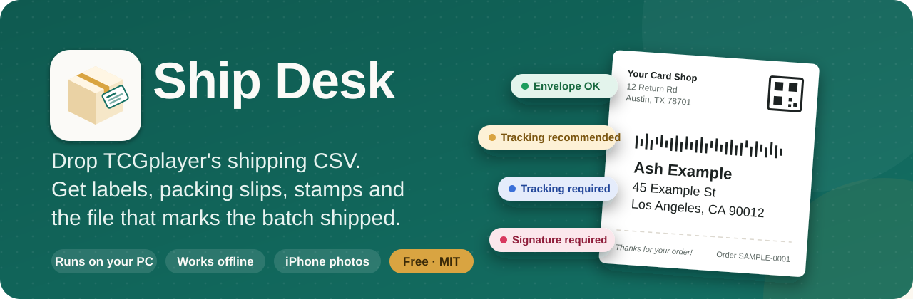

  
  
  
  
  
  

  <a href="https://github.com/mAgNiFiCeNtTaCo/Shipping/releases/latest"><b>Download for Windows</b></a> ·
  <a href="#install-and-start-it">Install</a> ·
  <a href="#the-4-steps">The 4 steps</a> ·
  <a href="#what-you-can-print-on">Print formats</a> ·
  <a href="#phone-photos">Phone photos</a> ·
  <a href="#honest-limits">Honest limits</a>

<table>
  <tr>
    <td width="50%" valign="top">
      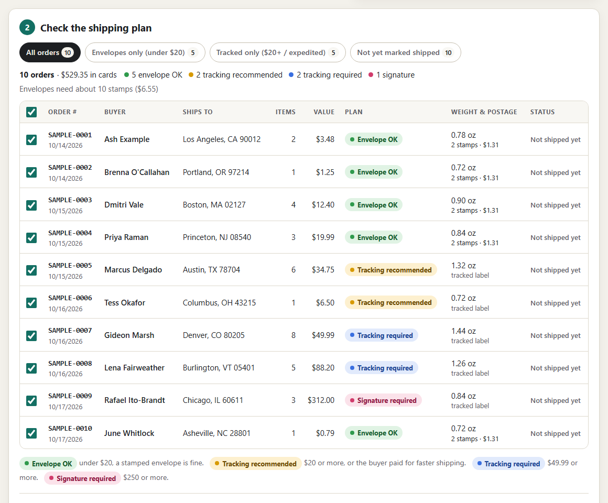
      
<b>A plan for every order.</b> Envelope or tracked label, weight, and how many stamps.

    </td>
    <td width="50%" valign="top">
      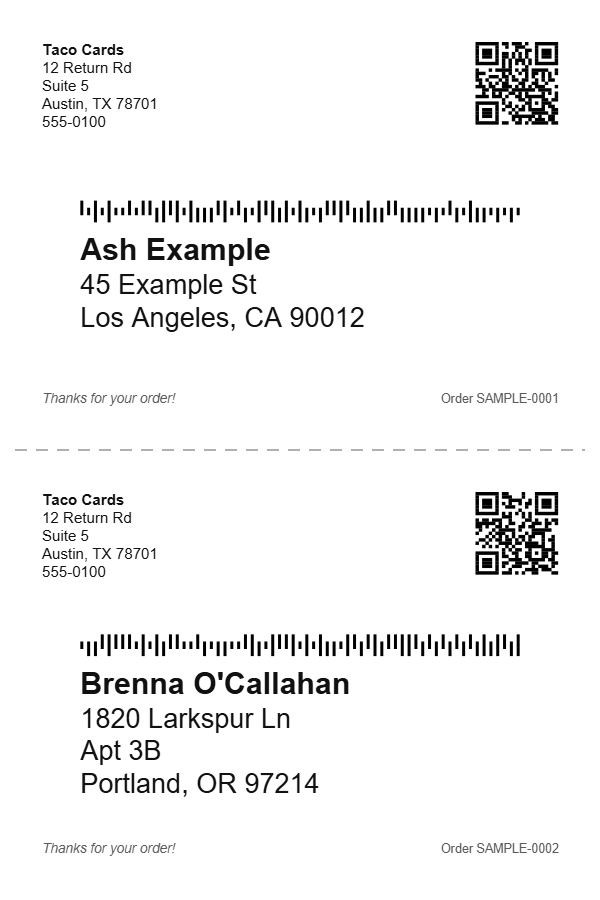
      
<b>Labels for the printer you have.</b> 4x6 thermal, letter sheets, Avery 5160 or straight onto a #10 envelope.

    </td>
  </tr>
  <tr>
    <td width="50%" valign="top">
      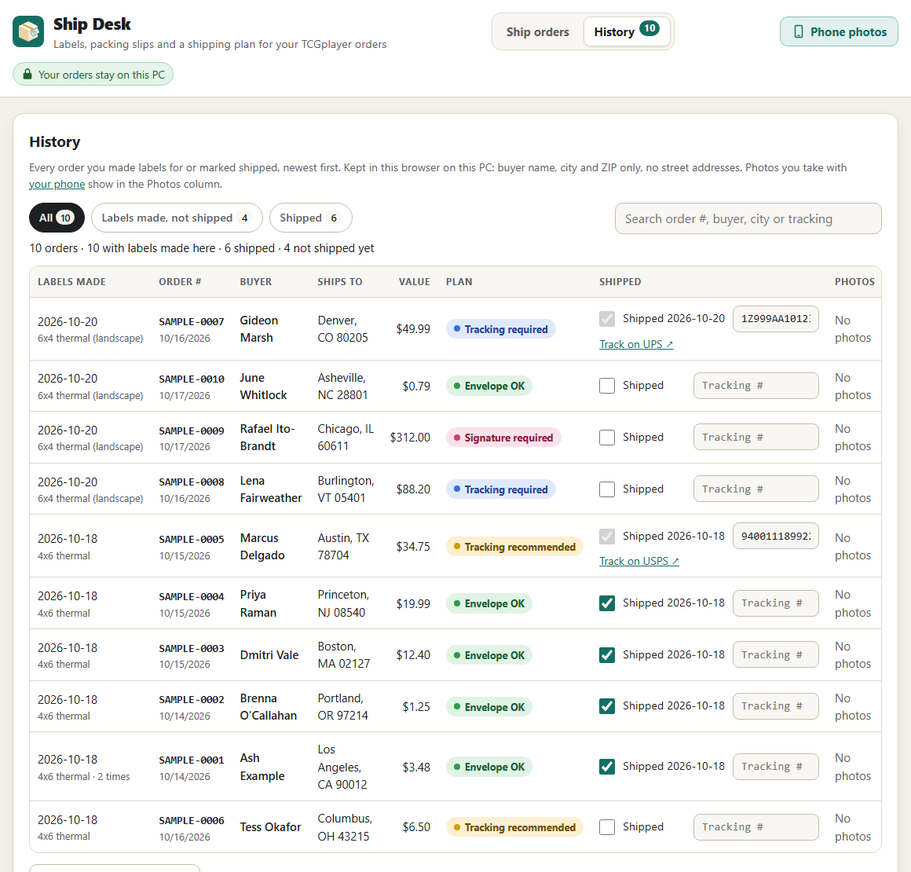
      
<b>History of what you shipped.</b> Tracking links, shipped ticks and the photos for each order.

    </td>
    <td width="50%" valign="top">
      

        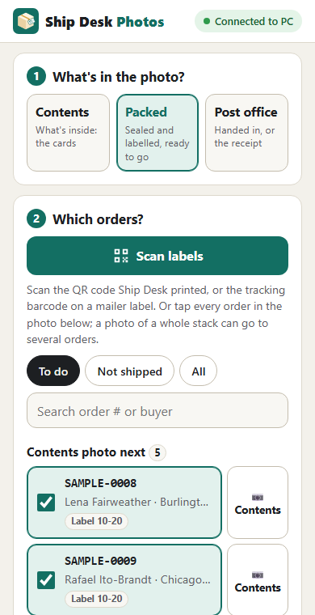
        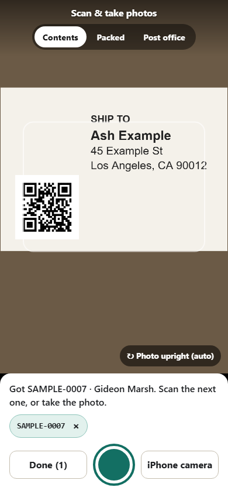
      

      
<b>Proof photos from your iPhone.</b> Scan the label, take the photo, it lands on your PC.

    </td>
  </tr>
</table>

### How a batch goes

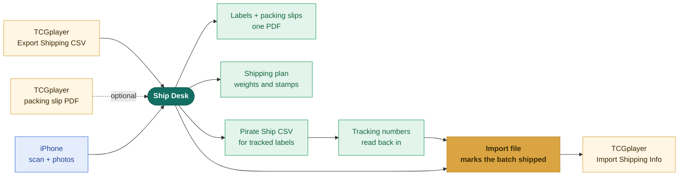
<!-- /github-only -->

# Ship Desk

Ship Desk turns your TCGplayer orders into print-ready **address labels, packing slips and envelopes**, tells you
**how to ship each order** (stamped envelope, tracking, or signature), estimates the **weight and stamps**, and makes
the **file that marks the orders shipped** on TCGplayer.

It runs on this PC in your web browser. Your buyers' addresses stay on this PC and are never put on the internet.
The only exception is your own phone (see "Phone photos"): through your private Tailscale network it gets each
order's buyer name, city, state and ZIP (no street) to pick from, and the photos you take of labels go back to
this PC.

## Install and start it

**With the installer** (`ShipDesk-Setup-<version>.exe`, Windows 10 or 11): run it and click through. It installs
for your Windows user only (no administrator needed) and brings everything it needs, its own Python included.
Setup asks:
- **where Ship Desk keeps your files** (labels, packing slips, import files, phone photos): `Documents\Ship Desk`
  unless you pick another folder. If OneDrive backs up your Documents, it suggests a folder OneDrive doesn't copy, and
  it warns you if you pick a OneDrive or Dropbox folder (labels hold buyers' addresses). A folder that already has
  other things in it gets a `Ship Desk` folder of its own inside it;
- whether to put an icon on the desktop, and whether Ship Desk should **start in the background when you sign in
  to Windows** (you can change that later at the top of the Ship Desk page);
- whether to **set up phone photos** straight away (Ship Desk then opens on its phone setup, which installs Tailscale
  for you: see "Phone photos").

Then open **Ship Desk** from the Start menu (or the desktop icon). Ship Desk starts in the background (no window
stays open) and your browser opens it (http://127.0.0.1:5091/). The first time, a **Welcome** checklist at the top
walks you through the setup: your return address, what you print on, a try with the sample orders, and the extras
(phone photos, backup, start with Windows, update notice). Each gets a tick when it's done; **Hide this checklist**
puts it away and **Setup checklist** at the top brings it back. The Start menu also has **Turn off Ship Desk**,
**Ship Desk files** (the folder with everything it made) and this guide. Windows may warn that the installer is from
an unknown publisher (it isn't signed): click **More info → Run anyway** if you trust where you got it.
To remove it: **Settings → Apps → Installed apps → Ship Desk → Uninstall**; it asks whether to delete the files it
made too (No keeps them). It only offers that for Ship Desk's own files folder (the one with `Ship Desk files.txt` in
it), so folders of yours are never deleted.

**From the source folder** (the GitHub copy): double-click **`Start Ship Desk.bat`** (it needs Python 3), and
**`Stop Ship Desk.bat`** to turn it off. Files then go to the `Saved` folder next to it.

Starting it when it's already running just opens the page. Messages and problems go to `ship-desk.log` in the
files folder; a problem that stops it from starting also pops up. No internet needed.

## The 4 steps

1. **Get your orders file from TCGplayer.** In the Seller Portal go to **Orders**, tick the orders you want to ship,
   and click **Export Shipping**. That saves a `.csv` file. (The **Packing Slip** button makes a PDF, which is a
   different thing, see "Your own packing slips" below.)
2. **Drop the CSV onto Ship Desk** (anywhere on the page), or click the drop box to pick it. Your orders appear in a
   table with a coloured tag for each one:
   - **Envelope OK**: under $20, a stamped envelope is fine.
   - **Tracked envelope (free)**: under $49.99 and fits a letter, when TCGplayer's tracked envelopes are switched
     on (see "TCGplayer tracked envelopes" below).
   - **Tracking recommended**: $20 or more, or the buyer paid for faster shipping.
   - **Tracking required**: $49.99 or more (TCGplayer's rule).
   - **Signature required**: $250 or more.

   Each order also shows its estimated packed weight and, for envelopes, how many Forever stamps it needs.
   Untick any order you don't want to print. The filter buttons show just envelopes, just tracked orders, or
   orders not yet marked shipped.

   The orders stay on the page when you reload it, close the browser or restart the PC, so you can make the
   TCGplayer import file later (after the phone has marked them shipped) without dropping the CSV again. They go
   away when you load a new file, press **Clear these orders** in step 1, or after 14 days. A packing-slip PDF
   (step 3) isn't kept: drop it again if you reprint.
3. **Print.** Fill in your return address once (it is remembered), pick what you print on, click
   **Download PDF**, open it and print at **100% scale** ("Actual size", not "Fit to page"). On a thermal label
   printer, set the margins to **zero**.
4. **Mark them shipped on TCGplayer.** In "Mark shipped", paste your tracking numbers or tick **Shipped** for
   envelopes without tracking, then click **Download TCGplayer import file**. Upload that file in the Seller
   Portal under **Orders -> Import Shipping Info**.

## What you can print on

| Choice | What you get |
|---|---|
| Thermal label 4 x 6 in | One label per 4x6 label (Rollo, MUNBYN, Dymo and similar). Packing slips come after, also 4x6. |
| Thermal label 6 x 4 in, landscape | The same 4x6 label with the address turned sideways (reads along the long side). The PDF page is a normal upright 4x6, so the printer prints it whole; packing slips come after, upright. |
| Thermal label 4 x 6 in, 2 envelope labels to cut apart | Two 4 x 3 in labels on each 4x6 label, a dashed line between them: cut and stick one on each plain envelope. Return address, order QR code, TCGplayer's tracked-envelope barcode and the buyer's address. |
| Letter paper, 1 / 2 / 3 / 4 labels per page | Full sheet, halves, thirds or quarters, with dashed cut lines. |
| Letter paper, label + packing slip | Label on the top half, packing slip on the bottom half of each page. |
| Thermal label 6 x 4 in, landscape envelope label | The same envelope label, bigger: one per 4x6 label, turned sideways (6 x 4 in), no cutting. Fits a #10 envelope. |
| Letter paper, envelope labels to cut out | The same small envelope label, 8 per page (4.25 x 2.75 in each) with dashed cut lines. |
| Avery 5160 / 8160 | 30 address labels per sheet (just the buyer's address). |
| #10 envelope | Prints straight onto a 9.5 x 4.125 in envelope; the stamp corner is left empty. |

<!-- github-only -->

  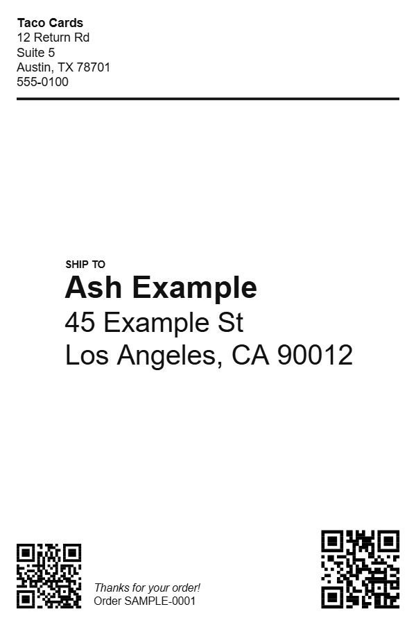
  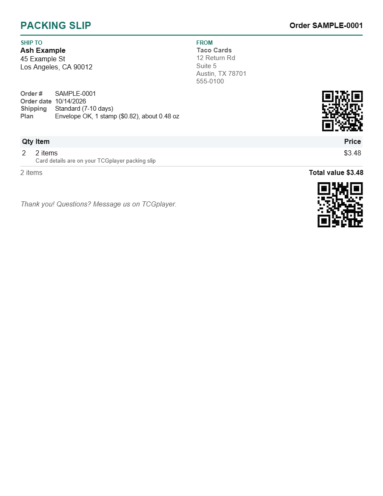
  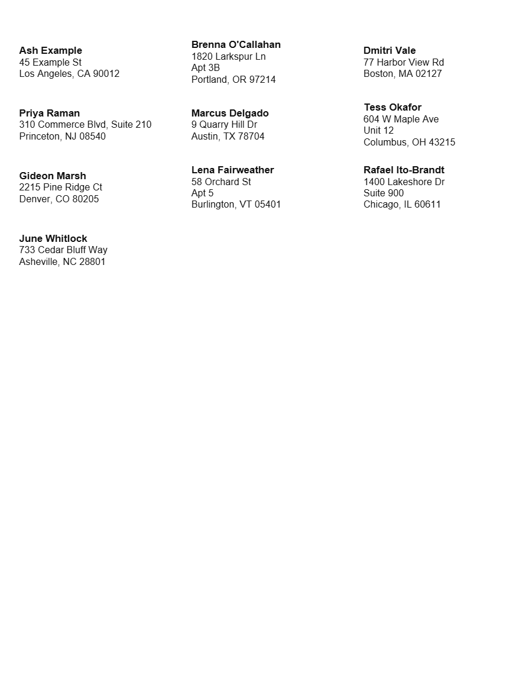

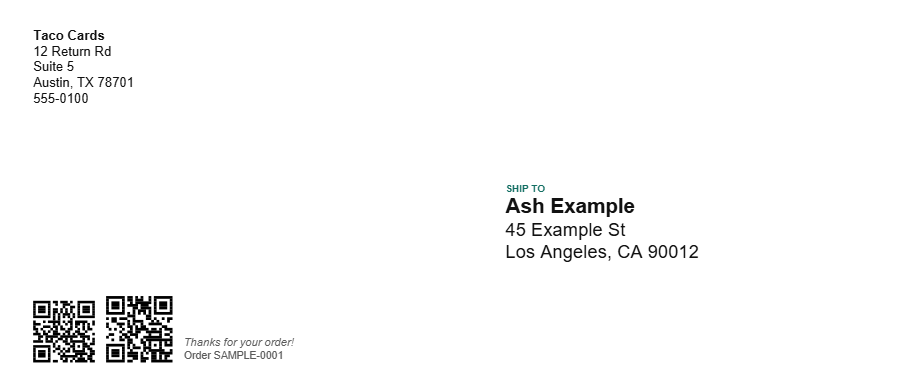

<!-- /github-only -->

Tick boxes under the picker: **Packing slips too**, **Bold return address** (darker on thermal printers) and
**No divider line** (leaves room for stamps or a postage meter).

## Your own packing slips

Drag the PDF from TCGplayer's Packing Slip button onto the Ship Desk page (together with the CSV if you like), or
click **+ Add TCGplayer packing slips (PDF)** and pick it. Ship Desk
reads which cards are in each order and lists them on its own slips. Tick **Slips in label order** to print
TCGplayer's own slip pages sorted to match your labels instead. That box starts unticked every time you open Ship Desk.

## Paste addresses (eBay, Whatnot, PayPal, email)

Not a TCGplayer order? Open the **Paste addresses** tab in step 1 and paste the addresses, each one on its own
lines (name, street, city ST ZIP) with a blank line between them. You get the same labels and slips. (These
can't go in the TCGplayer import file, because they aren't TCGplayer orders.)

## Make the labels yours

Open **Label design** in step 3: accent colour, font (Sans, Serif or Mono), your logo, thermal darkness, a short
note on each label (up to 60 characters), a QR code to your store, and a message on the packing slips.
**Order QR code** (on by default) prints a small QR code for the order on every label, envelope and packing slip,
for the phone's **Scan labels** (see "Phone photos"). It holds only the order number (for pasted addresses: the
buyer's name and ZIP).

**Weights and postage settings** (under the table in step 2) set the weight of a card, envelope, slip and
toploader, how many cards go in one toploader, whether your envelopes are rigid (adds USPS's non-machinable charge) and the Forever stamp price.

## TCGplayer tracked envelopes (from November 2026)

TCGplayer is adding free tracking for envelope orders: for orders of $49.99 and below going to a checked US
address, its packing slip carries a USPS barcode (an "Intelligent Mail barcode"). You still put on your own stamps.
TCGplayer's way is a window envelope with the slip showing through the window. Sellers get it between
2026-11-02 and 2026-11-06, in the new Orders page of the Seller Portal ("packing slip with tracking").

- Tick **I use TCGplayer's free tracked envelopes** in **Weights and postage settings** once you have it. Orders
  under $49.99 that fit a letter then show **Tracked envelope (free)** instead of "Envelope OK" or "Tracking
  recommended". They count as envelopes with stamps, and they no longer go in the Pirate Ship file. An order whose
  buyer paid for faster shipping still gets a tracked label.
- **Plain envelopes instead of window envelopes:**
  1. Drop the orders' Export Shipping CSV as usual.
  2. In TCGplayer, make the packing slips with tracking and save them as a PDF. Add that PDF in step 3
     (**+ Add TCGplayer packing slips**). Ship Desk reads each slip's barcode and the address TCGplayer checked
     for it (with ZIP+4), and says how many slips have one.
  3. Pick **Thermal label 4 x 6 in, 2 envelope labels to cut apart**, **Thermal label 6 x 4 in, landscape envelope
     label** (one bigger label, no cutting) or **Letter paper, envelope labels to cut out**, click **Download PDF**
     and print. The **Print envelope labels** button under the slip message picks the first one and turns the slips off. Cut along the dashed lines and stick one label on each envelope.
     Each label has your return address top left, the order's QR code, the barcode, and the buyer's address under it.
     Tick **Slips in label order** to print TCGplayer's own slips after the labels, to go inside.
  The barcode also prints on the other formats (under the address), but not on Avery labels (too small).
- Checked on a real tracked slip (2026-11-19): TCGplayer writes the barcode as text in a barcode font, so Ship Desk
  reads it exactly, and its numbers pass USPS's check. USPS's machines read the barcode on a label just as well
  (it sits in the address block, as USPS allows).
- **Tracking number:** Ship Desk keeps each order's barcode number when you make its labels. When the order is marked
  shipped (a post office photo after scanning the label's QR code, or the Shipped tick), that number goes in its
  tracking box (the 20-digit barcode number + the buyer's ZIP, the way TCGplayer shows it), so you can see it in Ship Desk instead of looking it up on TCGplayer. The phone doesn't need to read
  the barcode itself: the QR code next to it says which order it is. Orders marked shipped before this (2026-11-26) get
  their number when you add their slip PDF again. The TCGplayer import file still says "Shipped" for these orders:
  TCGplayer put that tracking on the order itself when it made the slip.
  USPS's own tracking page doesn't find these numbers (tried 2026-11-26), so History's link for them is **Track on
  TCGplayer**, which opens TCGplayer's tracking page (`tcgp.shipment.co/track/<number>`).
- **TCGplayer's protection:** TCGplayer's help article (as quoted by other sellers' tools; it can't be read from here)
  says to put the tracked slip in a standard #10 window envelope and not to use it with a plain envelope. So a label on
  a plain envelope is your own choice: the tracking works, but TCGplayer may not count it for its "not received"
  protection. For orders where that protection matters, use TCGplayer's way (the slip in a #10 window envelope), or
  ask TCGplayer support first.

## Tracking and Pirate Ship

- In **Mark shipped**, paste one tracking number per line. Either just the numbers, in the same order as your
  labels, or the order number then the tracking number (`SAMPLE-0005 9400 1000 ...`). Or type a number into an
  order's box.
- **Every shipped order goes in**, also ones whose TCGplayer file isn't loaded any more (for example labels made
  yesterday, post office photos today). Ship Desk remembers the TCGplayer rows of every file you load for 14 days (in
  this browser only); for an order without one it builds the row from History (order #, buyer, city, state, ZIP and
  tracking, no street). Step 4 lists these ("Also going in: ...") and the button counts them. If TCGplayer refuses
  one of those rows, export that order from TCGplayer again (Export Shipping), drop the file here and make the
  import file again. Orders you shipped before Ship Desk's first import file were handled another way and stay out.
- **Only what's new:** the import file leaves out orders already in an earlier import file with the same tracking
  number (or "Shipped"); an order that got a tracking number since goes in again. Step 4 says how many were left
  out; tick **Put them in again** if an upload didn't go through.
- Orders of **$49.99 or more** must have tracking: Ship Desk warns you if one is ticked Shipped without it.
- **Download Pirate Ship CSV** lists the orders that should get a tracked label and don't have one yet, with their
  estimated weight. In Pirate Ship choose Import -> Spreadsheet.
- **Tracking numbers back from Pirate Ship:** in Pirate Ship open **Reports -> View All Shipments** and click
  **Export**. Drop that `.xlsx` file anywhere on Ship Desk. Each label's tracking number goes on its order, matched
  by the buyer's name: the buyer's one order without tracking from the 3 weeks before the label. If a buyer
  has two or more such orders, Ship Desk doesn't guess: it lists the label so you can type it on the right order.
  It also says which labels were already there, which didn't match, and leaves out voided labels and labels
  older than any order it knows. Dropping the same file again is harmless. Works with no orders loaded too
  (it marks them in History). The **Transactions** export is the money list and has no tracking numbers.
- Ship Desk remembers what you marked shipped, so if you drop the same file again those orders aren't ticked
  for printing. **Clear shipped history** forgets it.
- **Check against TCGplayer:** drop TCGplayer's order list (the export from the Seller Portal's Orders page, a file
  named `TCGplayer_OrderList_<date>_<time>.csv`) anywhere on Ship Desk. It compares what TCGplayer shows with what
  you did here and lists:
  - orders you shipped that are still **"Ready to Ship" on TCGplayer** (an import file not made or not uploaded):
    they go back in the next import file, also when they were in an earlier one;
  - orders "Ready to Ship" on TCGplayer that **aren't shipped in Ship Desk** (labels made or not; if a scanned mailer
    went to the same buyer it says so, so you can type the order # on it in History);
  - orders **canceled** on TCGplayer that you made labels for or shipped: don't send them;
  - orders TCGplayer **already shows shipped** (for example labels bought in Pirate Ship): they stay out of the import
    file and show "Shipped on TCGplayer".
  The time in the file name counts: an import file made after the list was exported is newer news than the list.
  Your loaded orders stay as they are.

## Turning Ship Desk off and on

The top of the page shows **Ship Desk on** with a **Turn off** button. Turn off asks first, then stops Ship Desk and
it stops running in the background. The page stays open (it works from its offline copy) and shows **Ship Desk is off** with
**Turn on**: click it and Ship Desk starts again. The first time, the browser asks whether this site may open
"Ship Desk": tick "Always allow" and click Open. If Ship Desk stops some other way (Turn off Ship Desk in
the Start menu, Stop Ship Desk.bat, a restart of the PC), the page notices within a few seconds.

- **Start with Windows** (the tick box next to the switch): Ship Desk starts in the background when you log in to
  Windows, without opening the browser. It's in Windows' own startup list, so **Task Manager → Startup apps**
  shows it as "Ship Desk" (and can switch it off too).
- While it's off, files save to your Downloads folder and the phone's photos wait on the phone.
- **Turn on** works because Ship Desk registers a `shipdesk://start` link with Windows (for your Windows user
  only) each time it starts. It only ever starts Ship Desk in the background (`pythonw serve.py`). To remove it: `reg delete
  HKCU\Software\Classes\shipdesk /f`.

## Where your files go (the Saved folder)

Everything Ship Desk makes is saved straight into its files folder, not into your Downloads: the folder you picked
when installing (`Documents\Ship Desk` unless you chose another; Start menu → **Ship Desk files** opens it), or the
**`Saved`** folder next to Ship Desk when it runs from the source folder. Below it's called `Saved`. Your browser's
other downloads still go to Downloads as before.

| Folder | What's in it |
|---|---|
| `Saved\Labels` | the label PDFs, named by time and buyers: `Labels 2026-10-21 14-05 - 3 orders - Zackery Twork, Ash Example, Pat Doe.pdf` (one order: `Label 2026-10-21 14-05 - Zackery Twork - <order #>.pdf`) |
| `Saved\Packing slips` | "Only my slips, in label order" PDFs |
| `Saved\TCGplayer import files` | the files you upload under Orders -> Import Shipping Info |
| `Saved\Pirate Ship` | Pirate Ship CSVs |
| `Saved\History` | History downloads, and the History copy (`ship-desk-history.json`, `Backups\`) |
| `Saved\Proof packs` | proof packs (one PDF per order: details, tracking, photos) |
| `Saved\Photos` | photos from your phone, one folder per order (see "Phone photos") |
| `Saved\Phone` | the phone's pairing code and the order list it picks from (name, city, ZIP) |

- Every file is named by what it holds and when (`Packing slips ...`, `TCGplayer import 2026-10-21 14-05 - 5 orders.csv`,
  `Pirate Ship ...`, `Ship Desk history ...`). Two files with the same name (same minute) are kept as `... (2).pdf`;
  nothing is overwritten.
- A PDF opens by itself in your PDF program as soon as it's saved (labels, packing slips, proof packs), so there's
  no hunting for it in the folder. Don't want that? Untick **Open each PDF once it's saved** under the Download PDF
  button. CSV files don't open by themselves.
- After each save the message shows where the file is, with **Open it** (for PDFs) and **Open the folder** buttons.
  Under the Download PDF button there is also **Open the Saved folder**.
- Labels and packing slips older than 2 weeks move into an **Archive** folder inside their own folder
  (`Saved\Labels\Archive`, `Saved\Packing slips\Archive`), so the folder and the file picker only show the last two
  weeks. That includes TCGplayer's packing-slip PDFs you downloaded into `Saved\Packing slips`. Inside `Archive` there
  is one folder per two weeks, named by its dates (`2026-11-16 to 2026-11-29`, always Monday to the second Sunday), and
  each file goes in the one for the day it was made. Nothing is deleted; Ship Desk tidies up each time it saves one of
  these and once an hour. A PDF that is open at that moment moves next time.
- Prefer your Downloads folder? Under the Download PDF button, **Where files go** -> **My Downloads folder**. Ship
  Desk remembers the choice.
- Ship Desk running in the background does the saving. If it's off, files fall back to your Downloads folder and the
  message says so.
- These files contain your buyers' names and addresses: they stay on this PC (the folder is never put in git or on GitHub),
  except for the Dropbox / OneDrive backup below if you switch it on.

### Backup to Dropbox (or OneDrive)

On the **History** page, tick **Back up the Saved folder every hour to** and pick **Dropbox** or **OneDrive**. Ship Desk
then copies everything new or changed in `Saved` to `Dropbox\Ship Desk backup` (or `OneDrive\Ship Desk backup`) right
away, a minute after each start, and every hour while it runs. Dropbox / OneDrive puts that copy in your account
online, so it survives a broken drive (it does hold buyers' names, addresses and photos). The line next to it shows the
last backup; **Back up now** and **Open the backup folder** are there too. Picking the other place backs up there from
then on; the old place keeps what it has until you delete it.
- Nothing is ever deleted from the backup: a file you delete in `Saved` stays in OneDrive.
- A label or slip that moves into `Archive` is copied again under `Archive` in the backup; its earlier copy stays too.
- Left out: the phone's pairing code (the phone's key stays on this PC), Ship Desk's log, half-written files.
- Getting files back: open the backup folder and copy what you need into `Saved`.

## History

Click **History** at the top to see every order you made labels for or marked shipped, newest first.

- An order is added when you click **Download PDF**, and updated when you mark it shipped (tracking number
  or the Shipped tick). Orders you mark shipped without printing here are added too.
- Each row shows when its labels were made and on what (4x6, Avery, ...; "2 times" if you reprinted), the order,
  buyer, city, value, plan, and whether it shipped (date, tracking number, a "Track on USPS/UPS" link).
- You can tick **Shipped** or type a tracking number right there, even days later without the file: a TCGplayer
  order then also counts as shipped in step 4, so it goes in the import file next time you load its CSV.
- Buttons: **All / Labels made, not shipped / Shipped / Not sent to TCGplayer yet**, a search box (order #, buyer, city or tracking),
  **Download history (CSV)** for Excel or Google Sheets, **Remove** on a row, and **Clear history**.
- **A copy on this PC:** History is also saved in `Saved\History\ship-desk-history.json` after every change, plus one
  dated copy per day (last 30) in `Saved\History\Backups`. If the browser loses its History (cleared browsing data,
  another browser), History shows **"A saved copy of your History is on this PC"** with **Restore the saved copy**
  (it also brings back which orders were shipped) or **Keep this browser's History**. A browser that lost its
  History never overwrites the saved copy before you choose.
- **Sent to TCGplayer:** orders in an import file are marked "Sent to TCGplayer <date>" in step 4 and History.
  **Not sent to TCGplayer yet** shows the TCGplayer orders you shipped that TCGplayer doesn't know about yet: never
  in an import file (orders shipped before Ship Desk's first import file count as handled), or still "Ready to Ship"
  on the last TCGplayer order list you dropped. After an order list, rows also say "Shipped on TCGplayer", "Still
  Ready to Ship on TCGplayer" or "Canceled on TCGplayer".
- **Proof pack:** in an order's photos window, **Make proof pack (PDF)** makes one PDF for a claim or a buyer's
  question: page 1 has the order, where it went, when the label was made and it shipped, the tracking number
  (with a link to the tracking page), when it went to TCGplayer, and every photo small with its time; then each
  photo full size. Saved in `Saved\Proof packs` as `Proof pack <date time> - <buyer> - <order #>.pdf`. No street address.
- Only the buyer's name, city, state and ZIP are kept, never the street address. Up to 5,000 orders; the oldest
  drop off after that.

## Phone photos

Take photos of each order with your iPhone: **what's inside** (the cards), the **packed** mail ready to go, and the
**post office** drop-off or receipt. They're saved on this PC in `Saved\Photos\<order # and buyer>\`, named
like `Packed 2026-10-20 16-25-03 ab12cd.jpg`, and show in History.

<!-- github-only -->

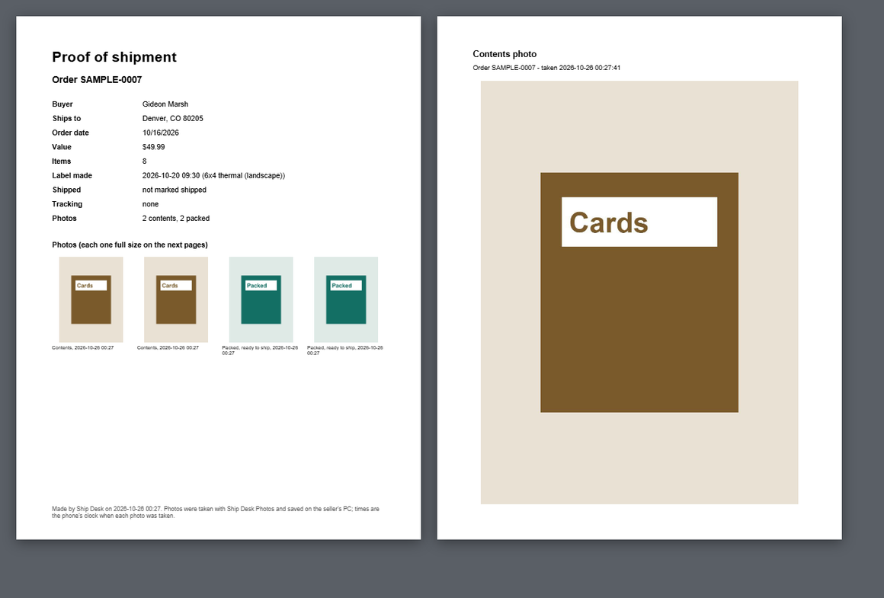

<!-- /github-only -->

**Set it up once:** click **Phone photos** (top right). The window takes you through four steps and moves on by
itself as each is done:
1. **Install Tailscale on this PC.** Your phone reaches this PC through Tailscale, a free private network between
   your own devices (nothing is opened to the internet). **Install Tailscale on this PC** downloads Tailscale's own
   installer, checks it is signed by Tailscale, and starts it: click through it (Windows asks for permission).
2. **Sign in to Tailscale** (free for personal use: Google, Microsoft, Apple or GitHub). The button opens Tailscale's
   sign-in page.
3. **Switch on phone access.** That gives the phone page an address only your own Tailscale devices can open. The
   first time, Tailscale may ask to switch on secure addresses (HTTPS) for your network: the window shows the link,
   click Enable there, then Switch on again. The rest of Ship Desk stays on this PC. Secure addresses put this PC's
   Tailscale name (for example `my-pc.tail1234.ts.net`) in a public list of web certificates; nobody can open it
   from outside your Tailscale devices, but a PC named after you shows your name there, so a plain PC name is better.
4. **Set up the phone:** install the Tailscale app (iPhone or Android), sign in with the same account, then point
   the phone's **Camera** at the QR code and tap the link. On an iPhone tap **Share → Add to Home Screen** in Safari:
   next time it's one tap.

**Taking photos:** **Scan labels** (or **Take photo** after ticking orders) opens Ship Desk's camera screen:
- It reads codes while you aim: the order QR code Ship Desk printed (label, envelope or packing slip) or the
  **tracking barcode** on a bubble mailer's label (Pirate Ship, USPS, UPS). Each one scanned joins the orders on
  screen; scan a whole stack one after another. Tracking barcodes read best with the barcode across the middle
  of the frame and filling most of its width; sideways or a little crooked is fine.
- Pick **Contents / Packed / Post office** at the top and press the round **shutter** as often as you like: a
  contents or packed photo goes to all the orders on screen, and you stay on the camera. Switch the type and keep
  shooting. **Done** goes back. (**iPhone camera** takes one photo with the iPhone's own camera app instead.)
- **Post office: one photo per order.** Scan an order's label, take its photo, scan the next, take its photo: each
  post office photo goes only to the order(s) scanned since the previous one (ticked ✓ on screen). Another photo
  without a new scan goes to the same order again (a retake).
- **Turned the right way:** the phone's tilt sensor tells which way you hold it, so photos taken sideways are saved
  turned upright. Shooting straight down at the desk keeps the way you last held it. The button on the picture
  ("Photo upright (auto)") shows what the next photo gets; tap it to turn by hand. The first time, the iPhone asks to
  allow "motion": tap Allow.
- Or tick the orders in the list and use **Choose photos** for pictures you already took.

**To do (the list the phone opens with):** the orders that still need something, grouped by the photo they need
next: **Contents photo next**, **Packed photo next**, **To the post office**. It lists orders not shipped yet that
had a label made in the last 14 days, are loaded on the PC, or have photos waiting on the phone. The camera button
next to an order picks it and opens the camera for the right kind of photo. At the post office, **Step through all**
opens the camera on the first order of the pile ("Post office photo for ... (1 of 4)"); each photo goes to that order
only and the next one comes up. Tap × on an order to skip it; scanning another label makes that order the current one. A packed photo is enough to move on (the contents photo isn't asked for again), and a post
office photo takes the order off the list. Orders you picked that aren't on the list show under **Picked** at the
top. **Not shipped** and **All** show the plain lists.

**Post office photos mark orders shipped:** when a post office photo reaches the PC, Ship Desk marks its orders
shipped (History and the TCGplayer import file), unless they already were: an order that already has its tracking
number or shipped date keeps them.

**Bubble mailers:** the first time you scan a mailer's tracking barcode that Ship Desk doesn't know yet, the phone
asks about it. Either **make a new entry**: type the buyer's name from the label (or tap the box and use the
keyboard's **Scan Text**), and the TCGplayer order # if you have it; or pick the order it belongs to. A new entry
without an order # shows in History as "Mailer scanned on the phone" with an **Add order #** box: type the
TCGplayer order # there later and it becomes that order (its photos move to the order's folder). The tracking number then goes to the PC (it waits on the
phone if the PC can't be reached, like photos) and Ship Desk puts it on the entry: it shows in **History** as
shipped with its tracking number, and goes in the **TCGplayer import file**, so there's nothing to paste. Next
time that barcode is scanned it picks the order straight away. Tracking numbers you pasted in Ship Desk work the
same way.

**No connection? Nothing is lost.** Every photo is kept on the phone until the PC says it saved it. At the post
office, or with the PC off or Ship Desk closed, the phone shows "PC offline · 2 waiting". The page still opens with no
signal (from the home-screen icon), and the photos go to the PC by themselves the next time Ship Desk is running
and you open the page.

**On the PC:** History has a **Photos** column ("4 photos: 2 contents, 2 packed"); click it to see them, or
**Open this order's photo folder**. Under each photo, **↺ / ↻** turn it a quarter left or right (the saved file is
turned). Orders of the loaded file that get photos, and orders given a tracking number on the phone, are added to History.

- Photos are shrunk to at most 2560 pixels on the long side and re-saved as JPEG, which also strips the
  phone's location data.
- **New pairing code** (in the Phone photos window) stops phones that used the old one, until they scan
  the new code. Their waiting photos are kept. **Switch off phone access** closes the address again.
- Tracking barcodes: hold the phone so the label fills about half the screen and the barcode is sharp; it reads
  on white, grey or brown mailers, upright or sideways.
- The camera needs the page to be allowed to use it; if it won't start, **Take a picture of the code** reads the
  code from a photo instead. After **Done** the camera stays ready for 5 minutes, so opening it again doesn't ask
  again; it switches off when you leave the app.
- The phone marks an order shipped only with a post office photo or a mailer's tracking number. Contents and
  packed photos don't.

## Where your data is kept

Only in this browser on this PC: your return addresses, design and settings, which orders you marked shipped,
the History list, and the orders you last loaded (with their addresses, until you clear them or 14 days pass).
Order files are read in the browser and never uploaded. Ship Desk goes on the internet only for the
**update notice** (once a day it asks GitHub for the newest version number; nothing about your orders is sent;
switch it off on the History page or in the setup checklist) and, when you ask for it, to download Tailscale's
installer. Once a phone is set up, Ship Desk keeps the list
the phone picks from (order #, buyer name, city, state, ZIP; no street) in `Saved\Phone`. Photos are in
`Saved\Photos`. Both stay on this PC (unless you switch on the Dropbox / OneDrive backup). A different browser (or
another PC) starts empty.

## Honest limits

- These are **address labels, not postage.** Add stamps, or buy a tracked label (Pirate Ship, USPS, ...) for
  orders that need tracking.
- Stamp counts are estimates from USPS's letter prices (from 2026-10-04) and the weights in your settings.
  Weigh a heavy order to be sure.
- The import file for orders shipped without tracking (`Shipped` in the tracking column, carrier `USPS`) was
  confirmed on a real upload on 2026-10-25 ("1 row successfully imported"; an empty carrier had been refused).
- The **card list from TCGplayer's packing-slip PDF** was checked on a real slip on 2026-10-26. If a slip shows
  "Card details are on your TCGplayer packing slip" instead of the cards, the reader didn't recognise the layout:
  use **Slips in label order** to print TCGplayer's own slips.

## Licence

Ship Desk is free to use and share under the **MIT licence** (`LICENSE`; `LICENSE.txt` in the installed folder). It
comes with no warranty. It includes other people's libraries and a copy of Python, listed with their licences in
`installer/THIRD-PARTY-NOTICES.txt` (`THIRD-PARTY-NOTICES.txt` in the installed folder).

## For developers

Static browser app in `app/` (no build step), served by `serve.py`. Tests: `python tools/test.py` (runs every
suite in headless Edge). Windows installer: `python tools/build_installer.py` (needs Inno Setup 6) ->
`dist\ShipDesk-Setup-<version>.exe`; the version is `APP_VERSION` in `serve.py`, the setup script `installer/ShipDesk.iss`. Screenshots: start `python serve.py --no-browser --port 5098`, then
`python docs/make_screens.py`. Build spec: `CONTRACT.md`; test results: `docs/TEST_REPORT.md`.
